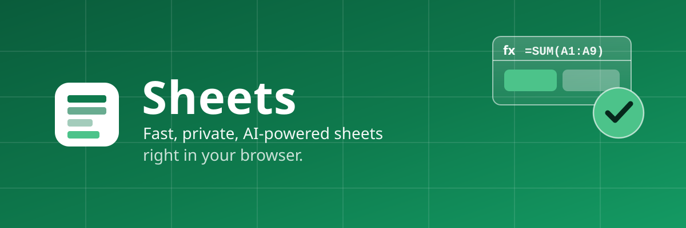

# Sheets

*Your numbers, your files, your cloud — nothing else.*

Sheets opens straight into a blank sheet. No sign-in wall, no loading spinner
audition, no framework megabytes standing between you and the cell. Type, and it
calculates. Over five hundred formulas, live, in a grid that answers before you
finish asking.

When you're done, what you have is a real `.xlsx` file — one that Excel,
Numbers and LibreOffice open without a second thought. Not an export. Not a
copy. The file itself, kept where you keep your things.

🌐 **Try it now:** https://salim-studio.github.io/sheets/

## Principles

1. **Start instantly.** A new sheet is one click away, account or not. Drafts
   survive closed tabs and dropped connections on your own device.
2. **Own your work.** Every workbook is a standard `.xlsx` document in your own
   cloud, with version history. Leave any time — your files come with you.
3. **Stay private.** No analytics, no tracking pixels. The AI assistant reads
   your cells only to do what you asked, shows each step, and undoes it all
   with one click.
4. **Respect the craft.** Vanilla JavaScript, no frameworks. Keyboard-first:
   every action lives a shortcut away. Light and dark modes that follow the
   system, regional formats that follow you.

## What it does

**Thinks in formulas.** 500+ functions — math, statistics, distributions,
logic, text, lookup (`XLOOKUP`, `INDEX`/`MATCH`), dates, finance, engineering —
plus `LET` and `LAMBDA` with `MAP`, `REDUCE`, `SCAN`, `BYROW`, `BYCOL` and
`MAKEARRAY`. Arrays spill into neighboring cells; anything in the way politely
reports `#SPILL!`.

**Draws the picture.** Column, bar, line, area, pie, donut, scatter, combo,
histogram, waterfall, radar, bubble, treemap, sunburst, box & whisker, funnel,
stock and surface charts — plus sparklines inside cells. Charts live in the
`.xlsx` file, not beside it.

**Organizes the mess.** Tables, filters, multi-key sorting, subtotals, pivot
tables, goal seek, a full solver, data-analysis tools, validation, dropdowns,
checkboxes, conditional formatting and cell styles.

**Works beside you.** An AI assistant that adds totals, writes formulas,
formats, sorts and charts — narrating every step. JavaScript automation with a
built-in editor, one-click samples and recordable actions. Fill handles that
learn series, paste special that respects intent, 200 levels of undo, regex
find & replace, frozen panes, groups, notes, hyperlinks, print layouts.

## Run it yourself

```bash
npm install
npm run dev      # local development at http://localhost:5173
npm test         # unit tests (vitest)
npm run build    # production build into dist/
npm run preview  # preview the production build
```

Every push to `main` ships to GitHub Pages through
`.github/workflows/pages.yml`.

## Under the hood

| Path | What lives there |
| ---- | ---------------- |
| `src/main.js` | Entry, routing, window title |
| `src/core/` | Workbook engine: formulas, `.xlsx` I/O, charts, pivots |
| `src/ui/` | Toolbar, menus, dialogs, formatting panes |
| `src/views/` | Home, editor, sign-in and error screens |
| `src/collab/` | Live co-editing room worker client/server |
| `src/workers/` | Background workers (e.g. email) |
| `tests/` | Vitest suites for formulas and behaviors |
| `public/` | Icons, `manifest.json`, fonts, install assets |
| `dev/` | Icon/thumbnail generators, mocks, link-preview sources |

## Identity

Emerald, like a fresh ledger. Light `#0E7A4D` over paper, `#4CC38A` glowing
out of the dark — the same green from the squircle icon to the install splash
(`public/manifest.json`, id `sheets-app`).

`icon.png` is the single source for the logo and install icons. Replace it,
then run `npm run icons` (needs ImageMagick) to regenerate favicons, the Apple
touch icon and the maskable set.

## License

MIT — © 2026 salim-slimani. See [LICENSE](./LICENSE).
